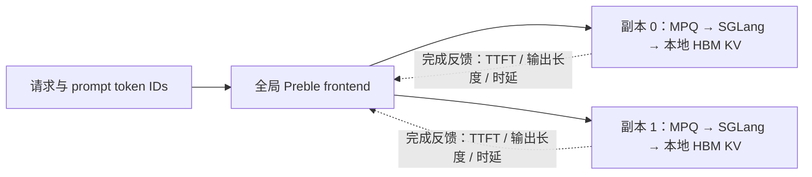

# Preble 实现与运行方法

本项目把 [WukLab/Preble](https://github.com/WukLab/preble) 的**公开服务默认路径**移植到当前 SGLang。参考 commit 固定为 [`1a35eae20c416f7062ca81775aab72890323fd97`](https://github.com/WukLab/preble/tree/1a35eae20c416f7062ca81775aab72890323fd97)，SGLang base 为 `ef11e3904885c8050f167a4a6f805da03e9e9bae`，不安装旧版 SGLang fork。

论文：[Preble: Efficient Distributed Prompt Scheduling for LLM Serving](https://arxiv.org/abs/2407.00023)。大模型实测、逐轮数据及局限见 [RESULTS.md](RESULTS.md)。

## 请求经过哪里



Frontend 用 token radix tree 记录前缀归属，用窗口统计估计负载，再把同一份 token IDs 发给选中的 worker。每个 worker 独立维护真正的 KV cache。

全局树中有两类独立状态：`gpu_allocations` 表示将来的路由归属；`cached_gpus` / `evicted_gpus` 表示原版虚拟 GPU cache 的估计状态。两者都不是 worker 实际 KV 驻留的权威记录。容量不足时，全局模型模拟驱逐；实际 HBM 分配与驱逐由当前 SGLang radix cache 负责。Frontend 不接收真实 eviction 事件，也不计入生成输出的全部实际 KV 占用。

这里的 migration / replication 修改的是**未来请求的归属**。迁到另一副本后，由新请求重新计算并缓存前缀；没有跨 worker 搬 KV tensor，也没有接 Mooncake 或共享 DRAM。

## 全局调度伪代码

`segment` 是压缩 radix 节点自身的 token 段；`context_before` 是它之前的路径长度。大节点满足 `segment > context_before`；请求的 important node 是从叶子向上找到的第一个大节点。

```text
select(prompt_ids, output_budget):
    leaf, splits = virtual_radix.insert(prompt_ids)
    按原版规则继承 split 的归属、引用和窗口统计
    group = 最近的大祖先(leaf)

    if leaf.segment_tokens < leaf.context_before:
        candidates = leaf 向上找到的第一个非空归属集合   # exploitation
    else:
        candidates = 全部 worker                      # exploration

    对每个候选 w:
        load[w] = 所属前缀组的窗口 prefill 代价 + 在途 decode 代价
        victims = 按原版 virtual LRU 模拟释放 leaf.segment_tokens
        eviction[w] = victims 中大节点的预期重新 prefill 代价之和
    w = 原版最小代价选择(load + eviction)

    更新路由归属、虚拟缓存和路径引用；登记本次窗口统计
    若虚拟占用超过 w 的容量：执行虚拟驱逐
    若达到 warmup 且满足链深条件：按原版做 migration / replication
    转发 prompt_ids 到 w

finish(request):
    向 important node 记录 TTFT
    释放原 worker 的路径引用和请求预算（只释放一次）
    用实际输出长度与时延更新 worker 的 TPOT 样本
```

E2 判断使用**插入后的节点段长度**，没有改成“精确重复请求必定命中既有归属”。候选选择中原版的 worker ID 缺陷也保留，见下文。

设 `T(new_tokens, full_context)` 为 prefill 时间模型，前缀组 `g` 的路由负载为：

```text
prefill(g) = 窗口 miss_rate(g) × 请求数(g) × T(g.segment, g.context)
             / 归属 worker 数(g)
decode(g, w) = 在途引用数(g, w) × 预计输出长度(g) × median(TPOT[w])
load(w) = Σ [prefill(g) + decode(g, w)]，g 属于 w
```

预计输出长度的代码优先读取 `node.decode_length` 的中位数，但原版公开服务把收集该序列的语句注释掉了，本移植也保持这一行为，因此实际回退到该组最近记录的输出预算。实际完成长度用于更新 worker TPOT。保留原版窗口 expiry、split rename 和代价累积顺序。

**驱逐代价已经移植，CLI 默认开启。** 对每个候选，原版始终按“cache 已满”模拟释放新 leaf 段所需空间，并非只在虚拟容量满时才计罚。每个大 victim 的代价是 `miss_rate × count × T(segment, context)`，小节点为零；缺少窗口数据时按原版回退。它估计未来重算损失，不执行远端内存读写。

| 配置 / 机制 | 默认与原版行为 |
| --- | --- |
| 历史窗口 | 180 秒；`--window-seconds` 可改 |
| Prefill 模型 | 原 Mistral-7B / A6000 二维回归；`--prefill-time-scale` 整体缩放 |
| 初始 TPOT | 0.15 秒；实测可传 `--initial-tpot`，每 worker 保留最多 200 样本 |
| 虚拟容量 | 每 worker 198516 tokens；应传部署实际的 token 池容量 |
| Eviction | launch CLI 开启；`--disable-eviction` 为消融。类构造器默认 False 与原版一致 |
| Rebalancing | 默认开启；累计调度 `50 × worker 数` 后尝试，当前请求到 important node 链深小于 3 |
| 负载差阈值 | 最高 worker 的估计总负载不低于最低的 1.5 倍时考虑调整；仅计至少观察两次的组 |
| 多组 migration | 从小代价组开始迁，迁移不得反转两端估计负载顺序 |
| 单组 replication | 只有一个可拆热点时，后半窗 TTFT 均值至少为前半窗 2 倍才添加归属；两半均需样本 |

默认 TTFT 窗口为两个 90 秒区间。迁移不改变在途请求所在 worker。`--disable-rebalancing`、`--disable-eviction` 可分别做消融；`--prefill-tokens-per-second` 是可选线性模型入口，本次对齐实验**没有使用**它。

## Worker 本地 MPQ

```text
请求首次进入 / 重新进入等待队列:
    hit_rate = 本地匹配 token 数 / 请求 token 数
    固定分入 10 个组之一：0–10%、(10%,20%]、…、(90%,100%]

每次 prefill 决策:
    从 cursor 开始按 9→0 循环找第一个非空组
    组内按首次 scheduler 接收时间 FIFO 排序
    刷新所选组的匹配结果，但不重新分组
    最多取 10 × (group_index + 1) 个请求
    交给当前 SGLang PrefillAdder 检查 slot / token / chunk 预算
```

组成员是持久的，已经等待的请求不会因 cache 变化而每轮换组。实际 batch 仍受当前 runtime 预算约束；continuing chunk 保留原有准入路径。

## 与原版对应的位置

| 原版组件 | 当前文件 |
| --- | --- |
| [global_scheduler_with_time.py](https://github.com/WukLab/preble/blob/1a35eae20c416f7062ca81775aab72890323fd97/preble/global_scheduler_with_time.py) 的 E2、窗口代价、全局驱逐、重平衡 | [preble.py](../../python/sglang/srt/routing/preble.py)、[preble_cost.py](../../python/sglang/srt/routing/preble_cost.py) |
| [global_lru_cache.py](https://github.com/WukLab/preble/blob/1a35eae20c416f7062ca81775aab72890323fd97/preble/global_lru_cache.py) 的压缩树与虚拟 LRU | [preble_cache.py](../../python/sglang/srt/routing/preble_cache.py) |
| [ttft_overload_detector.py](https://github.com/WukLab/preble/blob/1a35eae20c416f7062ca81775aab72890323fd97/preble/ttft_overload_detector.py) | [preble_cost.py](../../python/sglang/srt/routing/preble_cost.py) |
| [model_rpc.py 的 MPQ](https://github.com/WukLab/preble/blob/1a35eae20c416f7062ca81775aab72890323fd97/python/sglang/srt/managers/router/model_rpc.py#L934) | [schedule_policy.py](../../python/sglang/srt/managers/schedule_policy.py)、[scheduler.py](../../python/sglang/srt/managers/scheduler.py) |
| [公开 HTTP 服务](https://github.com/WukLab/preble/blob/1a35eae20c416f7062ca81775aab72890323fd97/preble/server/server.py) | [launch_preble.py](../../python/sglang/launch_preble.py) |

必要适配：当前 `Req` / radix API、首次 scheduler receipt timestamp、`PrefillAdder` 和 continuing chunk 控制流；HTTP 使用现代累计 SSE，补充不可用 worker 过滤、取消清理与幂等 release；硬件容量与时间模型参数化。容量不足时的实际 batch 不承诺与旧 runtime 逐批相同。

原公开服务 [固定 `highest_idx=None`](https://github.com/WukLab/preble/blob/1a35eae20c416f7062ca81775aab72890323fd97/preble/server/server.py#L179)。模拟器 [依据窗口命中率传入的可选 hint](https://github.com/WukLab/preble/blob/1a35eae20c416f7062ca81775aab72890323fd97/preble/simulator.py#L349) 未暴露；不能据此声称覆盖官方模拟器全部分支。

为了保持原版行为，没有顺手修复以下原始缺陷：

- [多候选 argmin 返回列表位置而非 worker ID](https://github.com/WukLab/preble/blob/1a35eae20c416f7062ca81775aab72890323fd97/preble/global_scheduler_with_time.py#L291)。健康池超过两 worker 且候选为子集时可能选错；本次两副本实验不触发该情形。
- [Virtual eviction 可把父节点重复入堆](https://github.com/WukLab/preble/blob/1a35eae20c416f7062ca81775aab72890323fd97/preble/global_lru_cache.py#L323)，节点顺序还比较整个 ref-counter 向量，可能重复计数。
- [特定连续 split / expiry 下 finish 可能触发原断言](https://github.com/WukLab/preble/blob/1a35eae20c416f7062ca81775aab72890323fd97/preble/global_scheduler_with_time.py#L372)。差分验证记录双方共同失败，不把它算成成功处理。

Frontend 只支持同模型、同 tokenizer、单共享 cache namespace 的固定 worker 池。接口为原生 `POST /generate`，单条 text 或 input_ids、`n=1`；另有 `/health` 与 `/routing_stats`。不支持 OpenAI 路由接口、batch、LoRA、多模态、session 或 cache_salt；worker 必须使用累计 streaming 输出。

## 启动两份真实 235B 副本

以下对应 8×H200、两份 TP4 BF16 `Qwen/Qwen3-235B-A22B-Instruct-2507`。安装当前 checkout 的兼容环境；本次使用 Torch 2.11.0+cu128、sglang-kernel 0.4.4+cu129、FlashInfer 0.6.12，完整版本见结果。模型、frontend 和准备脚本必须使用同一 tokenizer。

```bash
export PYTHONPATH="$PWD/python${PYTHONPATH:+:$PYTHONPATH}"
export PREBLE_MODEL_PATH=/path/to/Qwen3-235B-A22B-Instruct-2507
```

分别在两个终端启动，下列 worker 0 的命令在 worker 1 改为 `CUDA_VISIBLE_DEVICES=4,5,6,7`、`--port 31001`、`--random-seed 556540270`：

```bash
CUDA_VISIBLE_DEVICES=0,1,2,3 python -m sglang.launch_server \
  --model-path "$PREBLE_MODEL_PATH" --tp-size 4 --dtype bfloat16 \
  --host 127.0.0.1 --port 31000 --random-seed 659938497 \
  --mem-fraction-static 0.90 --context-length 32768 \
  --max-running-requests 64 --chunked-prefill-size 512 \
  --schedule-policy fcfs-mpq --attention-backend triton \
  --moe-runner-backend flashinfer_cutlass --disable-cuda-graph
```

等待 `/health` 就绪并完成内核 warmup / 时间校准后，读取每端 `/server_info` 的 `internal_states[0].memory_usage.token_capacity`。TP4 的容量是整个副本的 token 池，**不能乘 4**。本次两端均为 328506 tokens；其他部署请用实际值。

```bash
python -m sglang.launch_preble \
  --worker-urls http://127.0.0.1:31000 http://127.0.0.1:31001 \
  --model-path "$PREBLE_MODEL_PATH" --host 127.0.0.1 --port 18000 \
  --max-tokens-per-worker 328506 328506 \
  --prefill-time-scale 2.387698396256729 --initial-tpot 0.06731290138453584
```

这里的时间参数是本次硬件上、正式实验前冻结的测量值，不是跨模型通用常数。可用 [calibrate.py](../../benchmark/preble/calibrate.py) 在自己的部署先 warmup，再用 cold 8K/16K/32K 与三种部分命中 profile 测量；输出保留 `T(new_tokens, context)` 的二维结构，只拟合一个整体 scale。

## 重放固定的原版 LooGLE 生成器

[prepare_reference_loogle.py](../../benchmark/preble/prepare_reference_loogle.py) 校验原 commit、源文件与旧 schema parquet 的 SHA，再直接执行原生成器的 AST 定义，包括原模板、QA 比例复制、两次 shuffle 和首尾截断。它只读取 tokenizer，不安装旧 runtime、不加载小模型。

```bash
mkdir -p preble-bench
git clone https://github.com/WukLab/preble.git preble-bench/reference
git -C preble-bench/reference checkout 1a35eae20c416f7062ca81775aab72890323fd97
curl --fail --location \
  https://huggingface.co/datasets/bigai-nlco/LooGLE/resolve/bdc356116a09a6a3d552e28a9f330878915b1696/shortdep_qa/test-00000-of-00001.parquet \
  --output preble-bench/shortdep_qa.parquet
python benchmark/preble/prepare_reference_loogle.py \
  --source-root preble-bench/reference --dataset preble-bench/shortdep_qa.parquet \
  --model-path "$PREBLE_MODEL_PATH" --output-dir preble-bench/reference-trace \
  --patterns 24 --requests 393 --max-new-tokens 45 \
  --seed 10 --uuid-seed 10 --arrival-seed 10 --rates 0.7 1.4
```

固定 UUIDv4 随机源，并显式设置 Python / NumPy seed 和 arrival RNG 边界，使当前依赖环境可重生成同一轨迹；这些是随机流适配，**不等同恢复论文当年的逐请求 trace**。正式轨迹为 24 文档、393 请求、13559–32722 input tokens、输出上限 45、temperature 0；`manifest.json` 包含数据/源码/tokenizer/生成版本及 SHA。

新部署可在正式重放前独立测量时间参数：

```bash
python benchmark/preble/calibrate.py \
  --workload preble-bench/reference-trace/loogle-24-393-reference.jsonl \
  --worker-urls http://127.0.0.1:31000 http://127.0.0.1:31001 \
  --max-new-tokens 45 --output preble-bench/calibration.json
```

把输出的 `prefill_time_scale` / `initial_tpot` 用于 frontend，并在正式实验前冻结。该命令测量新的校准值；本次已归档实验的校准使用另一份独立的 seed42 输入，具体来源和复现参数见 [RESULTS.md](RESULTS.md)。

每轮先等待在途请求归零，再 POST `/flush_cache?timeout=30` 到两端，确认返回 `Cache flushed.`；Preble 每轮重启全新 frontend。然后重放：

```bash
python benchmark/preble/bench_loogle.py \
  --workload preble-bench/reference-trace/loogle-24-393-reference.jsonl \
  --arrivals preble-bench/reference-trace/arrivals-r0.7.json \
  --policy preble --router-url http://127.0.0.1:18000 \
  --worker-urls http://127.0.0.1:31000 http://127.0.0.1:31001 \
  --requests 393 --rate 0.7 --concurrency 256 --output preble-bench/preble-r0.7-rep1
```

每档 0.7 / 1.4 RPS 各做两轮，使用对应的 `--arrivals` 文件和新 output 目录。`--arrivals` 决定实际计划到达，`--rate` 仅记录该档标签。输出文件已存在时不要复用。

主对照是 **Preble + MPQ 对 RR + LPM**：重启两 worker，把 `--schedule-policy` 改为 `lpm`，保留有效随机种子及其他参数；对相同 profile warmup 后冷启 cache，重放时用 `--policy round-robin` 直连两 worker，按请求 index 轮流选端。这个比较同时改变全局与本地策略，不能单独归因于全局路由。

每轮保存 `requests.jsonl` / `summary.json`，Preble 另保存最终 `/routing_stats`，核验 393 次成功、393 个 TTFT 及 `active=[0,0]`。TTFT / E2E 从计划到达 sleep 醒后起钟，包含客户端 semaphore 等候、HTTP 与 frontend 开销，但不包含 sleep 超时的唤醒迟延。吞吐分母是含到达等待和尾部排空的整轮时长，不是饱和吞吐估计。具体本次执行顺序与统计方法见 [RESULTS.md](RESULTS.md)。
